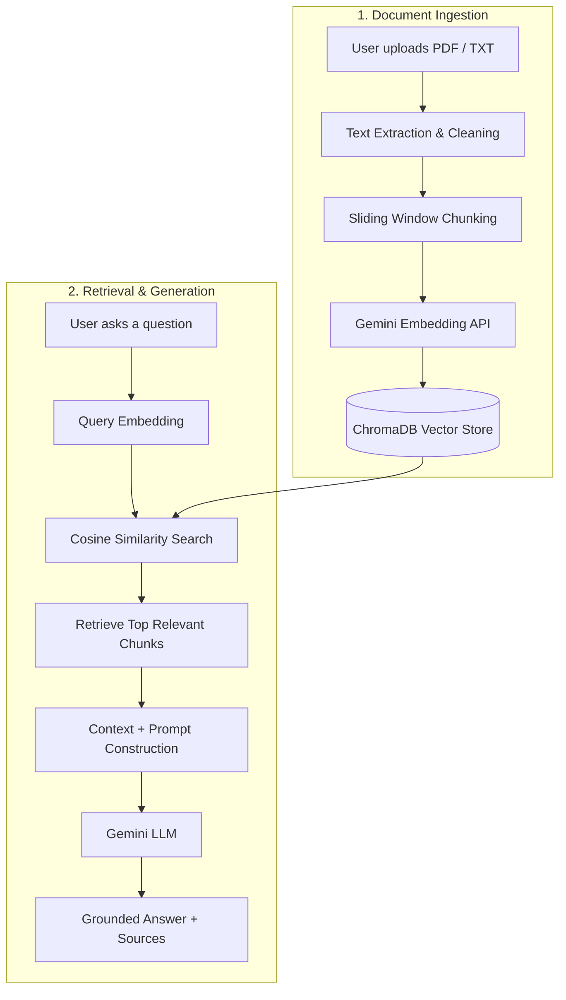

# 📄 RAG Document Q&A Assistant

A full-stack **Retrieval-Augmented Generation (RAG)** application designed to ingest documents (PDF/TXT), chunk and embed their content using **Google Gemini Embeddings**, index them into a vector database (**ChromaDB**), and deliver accurate, context-grounded answers powered by **Google Gemini** LLMs.

---

## 🌟 Key Features

- **Multi-Format Document Parsing**: Seamlessly process and extract raw text from `.pdf` and `.txt` documents.
- **Smart Chunking & Overlap**: Splits documents into semantically coherent segments (800 characters with 150-character sliding overlap) to preserve contextual boundaries.
- **High-Dimension Embeddings**: Leverages Google's `gemini-embedding-001` (3072 dimensions) for semantic vectorization.
- **Vector Database**: Connects to ChromaDB with cosine similarity vector search to retrieve the top $k$ relevant context chunks.
- **Zero-Dependency ChromaDB Server**: Includes an embedded Node.js ChromaDB-compatible server so you can run and test everything immediately without needing Docker or Python installed!
- **Strict Anti-Hallucination Guardrails**: The assistant is strictly instructed to answer based *only* on the provided context, stating `"তথ্য পাওয়া যায়নি"` (Information not found) when documents lack the answer.
- **Source Citation**: Every answer includes metadata linking back to the source file name and chunk index.
- **Modern Interactive UI**: Built with React 19 and Vite for a fast, responsive user experience.

---

## 🏗️ Architecture & Pipeline



---

## 📁 Project Structure

```text
rag-doc-qa/
├── backend/
│   ├── routes/
│   │   ├── chat.js            # Query embedding, vector retrieval & Gemini generation
│   │   └── upload.js          # File parsing, chunking & vector indexing
│   ├── chroma-server.js       # Standalone in-memory ChromaDB vector server (Port 8000)
│   ├── server.js              # Express API server entry point (Port 3000)
│   ├── package.json           # Backend dependencies and scripts
│   └── .env.example           # Environment variable template
├── frontend/
│   ├── public/                # Static assets & icons
│   ├── src/
│   │   ├── App.jsx            # Main Chat & Document Upload interface
│   │   ├── App.css            # Styles
│   │   └── main.jsx           # React DOM root
│   ├── index.html             # HTML entry point
│   ├── vite.config.js         # Vite configuration
│   └── package.json           # Frontend dependencies
├── .gitignore
└── README.md
```

---

## 🚀 Getting Started

### Prerequisites

- [Node.js](https://nodejs.org/) (v18 or higher recommended)
- A **Google Gemini API Key** (obtainable from [Google AI Studio](https://aistudio.google.com/))

---

### Step 1: Clone the Repository

```bash
git clone https://github.com/maishakhatun516-maker/rag-doc-qa.git
cd rag-doc-qa
```

---

### Step 2: Configure Environment Variables

Navigate to the `backend/` directory, copy the example environment file, and add your Gemini API key:

```bash
cd backend
cp .env.example .env
```

Open `.env` and set your key:

```env
PORT=3000
GEMINI_API_KEY=your_actual_gemini_api_key_here
```

---

### Step 3: Install Dependencies

#### 1. Backend:
```bash
cd backend
npm install
```

#### 2. Frontend:
```bash
cd ../frontend
npm install
```

---

### Step 4: Run the Application

You will need three terminal tabs/windows running:

#### Terminal 1: Vector Database (ChromaDB)
You can run the built-in standalone Chroma server:
```bash
cd backend
npm run chroma
```
> *Alternatively, if you prefer running official ChromaDB via Docker:*
> ```bash
> docker run -d -p 8000:8000 chromadb/chroma
> ```

#### Terminal 2: Backend API Server
```bash
cd backend
npm start
# or for development with auto-reload:
npm run dev
```
*Backend runs on `http://localhost:3000`.*

#### Terminal 3: Frontend Web UI
```bash
cd frontend
npm run dev
```
*Frontend runs on `http://localhost:5173`.*

---

## 📡 API Reference

### 1. Upload & Index Document
- **Endpoint**: `POST /api/upload`
- **Content-Type**: `multipart/form-data`
- **Body**: `document`: File (`.pdf` or `.txt`)
- **Response**:
  ```json
  {
    "message": "সফলভাবে প্রসেস হয়েছে",
    "fileName": "sample_doc.txt",
    "totalChunks": 4
  }
  ```

### 2. Query Document (Chat)
- **Endpoint**: `POST /api/chat`
- **Content-Type**: `application/json`
- **Body**:
  ```json
  {
    "question": "ডকুমেন্টের মূল বিষয়বস্তু কী?"
  }
  ```
- **Response**:
  ```json
  {
    "answer": "ডকুমেন্টের মূল বিষয়বস্তু হলো...",
    "sources": ["sample_doc.txt"]
  }
  ```

---

## 🛠️ Technology Stack

| Component | Technology | Description |
| :--- | :--- | :--- |
| **Frontend** | React 19, Vite | Fast, responsive Single Page Application (SPA) |
| **Backend** | Express.js, Node.js | REST API server with ES Modules support |
| **Document Parser** | `pdf-parse`, `multer` | Extracts text streams from uploaded PDF and text files |
| **Embedding Model** | `gemini-embedding-001` | High-dimensional semantic embeddings |
| **LLM Inference** | `gemini-3.1-flash-lite` / `gemini-3.5-flash` | Fast generation with low latency and fallback options |
| **Vector DB** | ChromaDB / Node Vector Engine | Vector indexing with Cosine Similarity nearest neighbor search |

---

## 🤝 Contributing

Contributions, issues, and feature requests are welcome! Feel free to check the [issues page](https://github.com/maishakhatun516-maker/rag-doc-qa/issues).

---

## 📝 License

This project is licensed under the MIT License.
